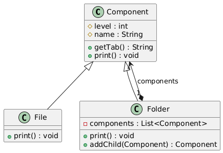
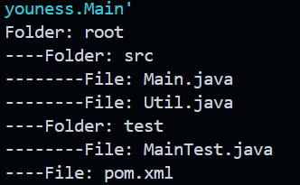

# Rapport de Travaux Pratiques : Design Pattern Composite

**Encadrant :** Mohamed YOUSSFI  
**Étudiant :** Youness HATTABI

---

## Table des Matières

1. [Introduction](#1-introduction)
2. [Présentation du pattern](#2-présentation-du-pattern)
   - 2.1 [Problème posé](#21-problème-posé)
   - 2.2 [Solution proposée](#22-solution-proposée)
   - 2.3 [Acteurs du pattern](#23-acteurs-du-pattern)
3. [Diagramme de classes](#3-diagramme-de-classes)
4. [Implémentation](#4-implémentation)
   - 4.1 [La classe abstraite `Component`](#41-la-classe-abstraite-component)
   - 4.2 [La classe `File` (feuille)](#42-la-classe-file-feuille)
   - 4.3 [La classe `Folder` (composite)](#43-la-classe-folder-composite)
5. [Tests et Résultats](#5-tests-et-résultats)
6. [Conclusion](#6-conclusion)

---

## 1. Introduction

Le pattern **Composite** est un pattern de conception _structurel_. Il permet de représenter des structures arborescentes de type « partie-tout » et de traiter de manière **uniforme** les objets simples et les objets composés.

Ce rapport l'illustre avec un système de fichiers simplifié : un `Folder` peut contenir des `File` ainsi que d'autres `Folder`, et l'on peut afficher toute l'arborescence en un seul appel.

---

## 2. Présentation du pattern

### 2.1 Problème posé

Dans une arborescence (fichiers et dossiers, menus et sous-menus, éléments graphiques imbriqués), le code client doit souvent distinguer les éléments simples des conteneurs. Cela multiplie les tests de type (`instanceof`) et complique le traitement récursif.

### 2.2 Solution proposée

Le pattern définit une abstraction commune, `Component`, pour les feuilles et les composites. Le composite contient une liste de `Component` et leur délègue les opérations. Le client manipule ainsi un `Component` sans savoir s'il s'agit d'une feuille ou d'un conteneur.

### 2.3 Acteurs du pattern

| Rôle      | Classe      | Responsabilité                                                  |
| --------- | ----------- | --------------------------------------------------------------- |
| Composant | `Component` | Abstraction commune, définit `print()` et `getTab()`            |
| Feuille   | `File`      | Élément sans enfant, s'affiche lui-même                         |
| Composite | `Folder`    | Contient une liste de `Component` et les parcourt récursivement |

---

## 3. Diagramme de classes

**Diagramme UML généré depuis IntelliJ IDEA :**



Lecture du diagramme :

- `File` et `Folder` **héritent** de `Component`.
- `Folder` **contient** plusieurs `Component` (association avec losange, attribut `components`, multiplicité `*`).

**Organisation du projet :**

```
src/main/java/
├── composite/
│   ├── Component.java
│   ├── File.java
│   └── Folder.java
└── hattabi/youness/Main.java
```

---

## 4. Implémentation

### 4.1 La classe abstraite `Component`

Elle déclare les attributs `level` (profondeur dans l'arbre) et `name`, ainsi que les méthodes `getTab()` et `print()`. La méthode `getTab()` retourne l'indentation correspondant à la profondeur, ce qui rend l'affichage lisible.

```java
package composite;

public abstract class Component {
    protected int level;
    protected String name;

    public Component(String name) {
        this.name = name;
    }

    public String getTab() {
        return "    ".repeat(level);
    }

    public abstract void print();
}
```

---

### 4.2 La classe `File` (feuille)

Une feuille n'a pas d'enfants : elle affiche uniquement son propre nom.

```java
package composite;

public class File extends Component {
    public File(String name) {
        super(name);
    }

    @Override
    public void print() {
        System.out.println(getTab() + "File: " + name);
    }
}
```

---

### 4.3 La classe `Folder` (composite)

`Folder` est à la fois un `Component` (héritage) et le conteneur d'une liste de `Component` (attribut `components`). La méthode `addChild` ajoute un enfant, fixe son niveau à celui du dossier plus un, et retourne l'enfant ajouté. La méthode `print` affiche le dossier puis délègue l'affichage à chaque enfant : c'est la **récursivité** propre au pattern.

```java
package composite;

import java.util.ArrayList;
import java.util.List;

public class Folder extends Component {
    private List<Component> components = new ArrayList<>();

    public Folder(String name) {
        super(name);
    }

    public Component addChild(Component child) {
        child.level = this.level + 1;
        components.add(child);
        return child;
    }

    @Override
    public void print() {
        System.out.println(getTab() + "Folder: " + name);
        for (Component c : components) {
            c.print();
        }
    }
}
```

---

## 5. Tests et Résultats

```java
package hattabi.youness;

import composite.*;

public class Main {
    public static void main(String[] args) {
        Folder root = new Folder("root");
        Folder src = new Folder("src");
        Folder test = new Folder("test");

        root.addChild(src);
        root.addChild(test);
        root.addChild(new File("pom.xml"));

        src.addChild(new File("Main.java"));
        src.addChild(new File("Util.java"));
        test.addChild(new File("MainTest.java"));

        root.print();
    }
}
```

**Sortie attendue :**

```
Folder: root
    Folder: src
        File: Main.java
        File: Util.java
    Folder: test
        File: MainTest.java
    File: pom.xml
```

**Capture de l'exécution :**



Un seul appel, `root.print()`, suffit à afficher l'arbre entier : `Folder` ne distingue pas les `File` des autres `Folder`.

---

## 6. Conclusion

Ce travail a permis d'implémenter le pattern Composite sur un exemple d'arborescence de fichiers. Il met en évidence la puissance de la récursivité combinée à une abstraction commune, qui permet de traiter toute la structure à partir d'un seul point d'entrée.
